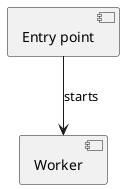
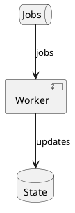

**Contents**

[1. Study scope](#report-section-scope) · [2. System context](#report-section-context) · [3. System components](#report-section-components) · [4. Startup and execution](#report-section-startup_and_flows) · [5. Data and state](#report-section-data_and_state)

<a id="report-section-scope"></a>

## 1. Study scope

<a id="report-block-b-001-001"></a>

The entry point starts the worker.

*Sources: [<code>vendor/worker/worker.py:12–18</code>](#report-source-study-e-002), [<code>app.py:1–1</code>](#report-source-study-e-001), [<code>config.py:3–5</code>](#report-source-study-e-003) (Quote mismatch; quote not verified)*

<a id="report-block-b-001-002"></a>

Repeated explanation.

*Sources: [<code>vendor/worker/worker.py:12–18</code>](#report-source-study-e-002), [<code>app.py:1–1</code>](#report-source-study-e-001)*

<a id="report-block-b-001-003"></a>

Runtime deployment is unknown.

*Limitation: no source evidence for Runtime deployment is unknown. (Unknown).*

<a id="report-block-b-001-004"></a>

### Investigated
The fixture describes a synthetic entry point.

### Partially investigated
None: this fixture has no incomplete execution chains.

### Unverified
Runtime behavior was not executed in this fixture.

### Out of scope
None: this fixture has no user exclusions.

<a id="report-section-context"></a>

## 2. System context

<a id="report-block-b-002-001"></a>

Introduction with no registered claim.  

<a id="report-section-components"></a>

## 3. System components

<a id="report-block-b-003-001"></a>

Repeated explanation.

*Sources: [<code>app.py:1–1</code>](#report-source-study-e-001), [<code>config.py:3–5</code>](#report-source-study-e-003) (Quote mismatch; quote not verified)*

<a id="report-block-b-003-002"></a>

| Component | Role |
| --- | --- |
| Worker | Processes jobs |

*Sources: [<code>vendor/worker/worker.py:12–18</code>](#report-source-study-e-002), [<code>app.py:1–1</code>](#report-source-study-e-001)*

<a id="report-block-b-003-003"></a>



*Sources: [<code>vendor/worker/worker.py:12–18</code>](#report-source-study-e-002), [<code>app.py:1–1</code>](#report-source-study-e-001), [<code>config.py:3–5</code>](#report-source-study-e-003) (Quote mismatch; quote not verified)*

<a id="report-section-startup_and_flows"></a>

## 4. Startup and execution

<a id="report-block-b-004-001"></a>

```plantuml
@startuml
## This is diagram text
Actor -> Worker: start
@enduml
```

*Sources: [<code>vendor/worker/worker.py:12–18</code>](#report-source-study-e-002), [<code>app.py:1–1</code>](#report-source-study-e-001)*

<a id="report-section-data_and_state"></a>

## 5. Data and state

<a id="report-block-b-005-001"></a>

Not applicable in this synthetic fixture.

<a id="report-block-b-005-002"></a>



*Sources: [<code>app.py:1–1</code>](#report-source-study-e-001), [<code>config.py:3–5</code>](#report-source-study-e-003) (Quote mismatch; quote not verified)*

### Source registry

| ID | File:lines | Source | Check | Used in |
| --- | --- | --- | --- | --- |
| <a id="report-source-study-e-001"></a><code>study:E-001</code> | <code>app.py:1–1</code> | <code>source-001</code> | Resolved; locator resolved; no quote supplied | [1. Study scope — block 1](#report-block-b-001-001), [1. Study scope — block 2](#report-block-b-001-002), [3. System components — block 1](#report-block-b-003-001), [3. System components — block 2](#report-block-b-003-002), [3. System components — block 3](#report-block-b-003-003), [4. Startup and execution — block 1](#report-block-b-004-001), [5. Data and state — block 2](#report-block-b-005-002) |
| <a id="report-source-study-e-002"></a><code>study:E-002</code> | <code>vendor/worker/worker.py:12–18</code> | <code>source-002</code> | Resolved; locator resolved; no quote supplied | [1. Study scope — block 1](#report-block-b-001-001), [1. Study scope — block 2](#report-block-b-001-002), [3. System components — block 2](#report-block-b-003-002), [3. System components — block 3](#report-block-b-003-003), [4. Startup and execution — block 1](#report-block-b-004-001) |
| <a id="report-source-study-e-003"></a><code>study:E-003</code> | <code>config.py:3–5</code> | <code>source-001</code> | Quote mismatch; quote not verified | [1. Study scope — block 1](#report-block-b-001-001), [3. System components — block 1](#report-block-b-003-001), [3. System components — block 3](#report-block-b-003-003), [5. Data and state — block 2](#report-block-b-005-002) |

### Source identities

| Source | Source identity |
| --- | --- |
| <code>source-001</code> | <code>{&quot;branch&quot;:&quot;main&quot;,&quot;commit&quot;:&quot;aaaaaaaaaaaaaaaaaaaaaaaaaaaaaaaaaaaaaaaa&quot;,&quot;mode&quot;:&quot;git&quot;}</code> |
| <code>source-002</code> | <code>{&quot;commit&quot;:&quot;bbbbbbbbbbbbbbbbbbbbbbbbbbbbbbbbbbbbbbbb&quot;,&quot;mode&quot;:&quot;git&quot;,&quot;parent&#95;commit&quot;:&quot;aaaaaaaaaaaaaaaaaaaaaaaaaaaaaaaaaaaaaaaa&quot;,&quot;submodule&#95;path&quot;:&quot;vendor/worker&quot;}</code> |

