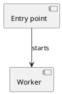
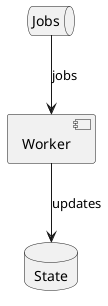

## 1. Study scope

The entry point starts the worker.

*Sources: [E-002](#source-e-002), [E-001](#source-e-001), [E-003](#source-e-003) (QUOTE_MISMATCH; quote not verified)*

Repeated explanation.

*Sources: [E-002](#source-e-002), [E-001](#source-e-001)*

Runtime deployment is unknown.

*Limitation: no source evidence for <code>C-003</code> (UNKNOWN).*

## 2. System context

Introduction with no registered claim.  

## 3. System components

Repeated explanation.

*Sources: [E-001](#source-e-001), [E-003](#source-e-003) (QUOTE_MISMATCH; quote not verified)*

| Component | Role |
| --- | --- |
| Worker | Processes jobs |

*Sources: [E-002](#source-e-002), [E-001](#source-e-001)*



*Sources: [E-002](#source-e-002), [E-001](#source-e-001), [E-003](#source-e-003) (QUOTE_MISMATCH; quote not verified)*

## 4. Startup and execution

```plantuml
@startuml
## This is diagram text
Actor -> Worker: start
@enduml
```

*Sources: [E-002](#source-e-002), [E-001](#source-e-001)*

## 5. Data and state

Not applicable in this synthetic fixture.



*Sources: [E-001](#source-e-001), [E-003](#source-e-003) (QUOTE_MISMATCH; quote not verified)*

### Source registry

| ID | File:lines | Source | Check |
| --- | --- | --- | --- |
| <a id="source-e-001"></a><code>E-001</code> | <code>app.py:1–1</code> | <code>source-001</code> | RESOLVED; locator resolved; no quote supplied |
| <a id="source-e-002"></a><code>E-002</code> | <code>vendor/worker/worker.py:12–18</code> | <code>source-002</code> | RESOLVED; locator resolved; no quote supplied |
| <a id="source-e-003"></a><code>E-003</code> | <code>config.py:3–5</code> | <code>source-001</code> | QUOTE_MISMATCH; quote not verified |

### Source identities

| Source | Source identity |
| --- | --- |
| <code>source-001</code> | <code>{&quot;branch&quot;:&quot;main&quot;,&quot;commit&quot;:&quot;aaaaaaaaaaaaaaaaaaaaaaaaaaaaaaaaaaaaaaaa&quot;,&quot;mode&quot;:&quot;git&quot;}</code> |
| <code>source-002</code> | <code>{&quot;commit&quot;:&quot;bbbbbbbbbbbbbbbbbbbbbbbbbbbbbbbbbbbbbbbb&quot;,&quot;mode&quot;:&quot;git&quot;,&quot;parent&#95;commit&quot;:&quot;aaaaaaaaaaaaaaaaaaaaaaaaaaaaaaaaaaaaaaaa&quot;,&quot;submodule&#95;path&quot;:&quot;vendor/worker&quot;}</code> |

